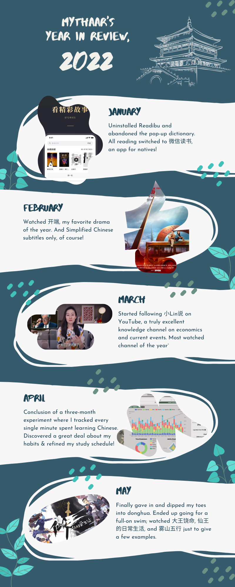
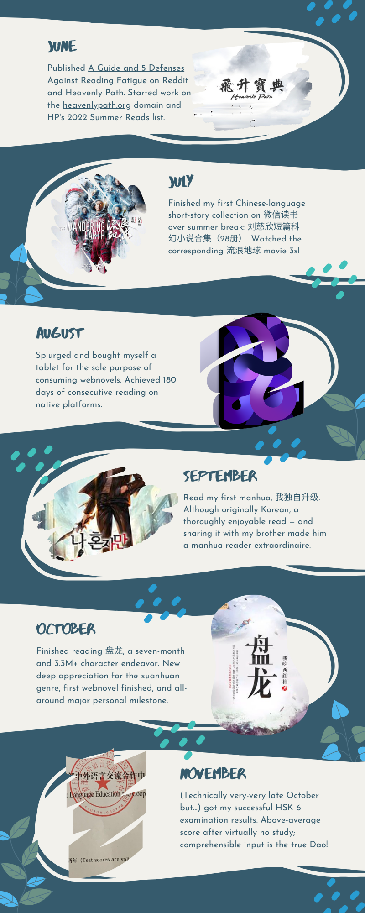
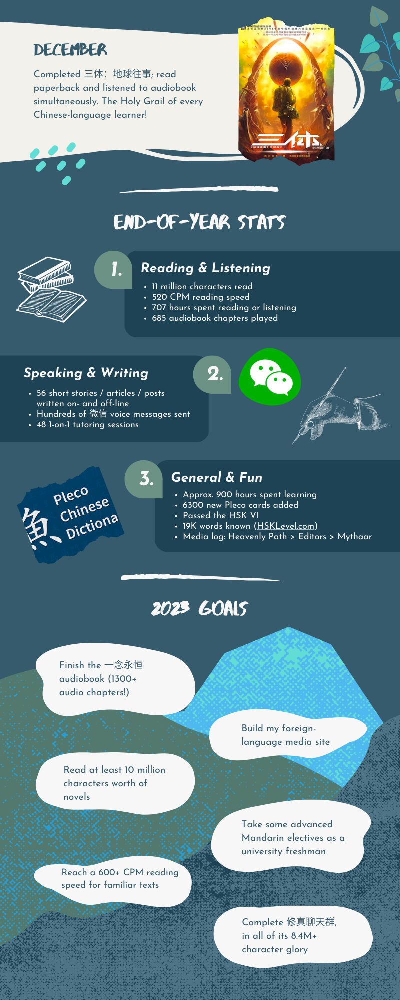

It's been a fulfilling year of learning Chinese, so I thought to make a poster to visually sum up my progress. Find it below, with month-by-month learning details, my 2023 resolutions, and end-of-year statistics!

