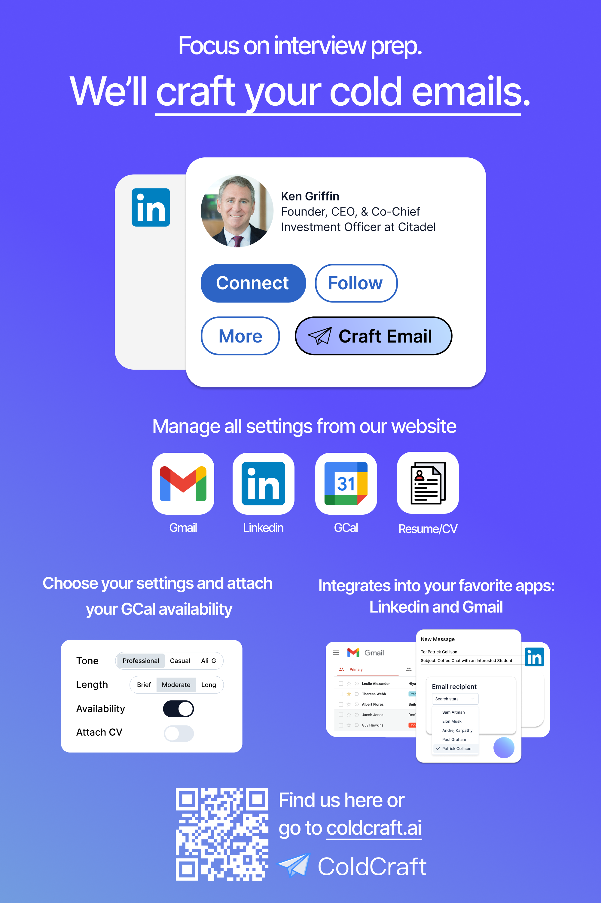

Another semester, another SaaS product launch! [Rishi Gurjar](https://www.linkedin.com/in/rishigurjar/) and I have spent the past month working overtime on [ColdCraft.ai](https://coldcraft.ai), an extension that integrates with your resume, Google Calendar, and LinkedIn to generate hyper-personalized cold emails.

Our goal? Letting you focus on interview prep & the important stuff, not endlessly rewriting the same cold email template.

After overwhelmingly positive beta feedback, as well as corporate awards at Cornell's annual project showcase from LinkedIn and Cisco, we're finally going public. Please consider giving us a whirl!

