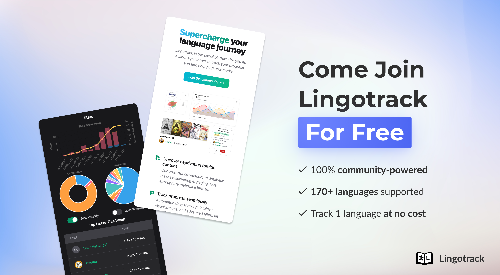

After 12+ months of hard work and lots of sleepless nights 😅, [Lingotrack](https://www.lingotrack.com) is finally ready to make your language-learning journey more social and just a tad less daunting.

Its inspiration comes from my experience learning Chinese over the pandemic. I quickly realized that motivation is key, especially for beginners or those stuck at the intermediate plateau. The tool tries to solve this through:

- Vibrant charts, easy logging, and a personal library system that makes progress almost tangible
- You're never alone — share goals, write reviews, view others' updates and find camaraderie in our hub
- A crowdsourced, difficulty-arranged database / lists of foreign media that makes choice paralysis or inaccessibility things of the past

You can sign up [here](https://www.lingotrack.com) at lingotrack.com. Those feeling generous can also [upvote the tool on ProductHunt](https://www.producthunt.com/posts/lingotrack) 🙏, where I got to #11 Product of the Day yesterday!

